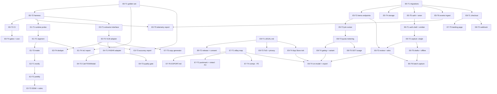

# SnapList — PLAN.md

Owner: **lead** (this file). One ticket = one unit of work a single role can finish and prove.
Every ticket names the files it may touch; touching anything else is a scope violation and the
integrator will reject it.

- 10 epics, **46 tickets**. Every ticket has an acceptance command; none has a stopwatch.
- Epic order is dependency order, not priority order. E0 comes first because every later "it
  works" claim needs a number behind it.
- Ticket id format: `E<epic>-T<n>`. Code comments reference these ids directly (e.g.
  `packages/vision/segment.py` says "see docs/PLAN.md ticket E1-T2"), so renaming a ticket
  means grepping for it.

> ### HARD CONSTRAINT — `<2 min/item` may not be an acceptance criterion
>
> BRIEF says the current state is ~8 min/item; PRD §3 adds the steps up to **19.5 min** and
> projects **8.5 min** after v1. Both figures are `ASSUMPTION`s, the conflict is unresolved, and
> neither is a test: end-to-end minutes per item cannot be scripted. So **no ticket in this file
> is accepted on a stopwatch reading.** Use the proxy metrics in §"Measurement contract" below
> (tool time p50 ≤ 35 s / p90 ≤ 60 s, `fields_touched` mean ≤ 5 **and** p90 ≤ 12, 60-minute
> export burst).
> `<2 min/item` survives **only as an internal assumption**. Until PRD §3 measures it, it must not
> appear in **any seller-facing material** — landing page, store copy, paywall, ads, sales DMs.
> A starred `<2 min*` is still read as a promise by a seller, and the person writing the
> landing page reads this line, not E7-T5 four hundred lines down. `docs/ONBOARDING.md` §4.1 is
> the stricter authority; when the two disagree, the stricter one wins.


## Global definition of done (applies to every ticket, not repeated below)

1. Files exist at the paths named in the ticket, and nowhere else.
2. `make test` exits 0 — paste the real output tail into `docs/HANDOFF-<role>.md`.
3. The ticket's own acceptance command runs and prints a real number or a real HTTP response.
   `UNMEASURED` is acceptable only for a metric whose ticket has not landed yet; "should work"
   is never acceptable.
4. No mocked model calls in the acceptance path. Fixtures on disk are fine; stubbed network
   responses are not.
5. New dependency ⇒ a row in `docs/DEPS.md` (name, version, licence, reason).
6. Any change to a shape in `docs/CONTRACTS.md` ⇒ ADR + version bump, in the same PR.
7. **If a ticket adds a user-visible step, it emits that step's analytics event in the same
   PR** (`docs/CONTRACTS.md` §7, `packages/shared/src/analytics.ts`). An unmeasured step is a
   step nobody can defend later. Six event names, frozen; a seventh needs an ADR.
8. **Every seller-facing failure renders the copy from `docs/CONTRACTS.md` §6, never a
   `reason_code`.** The enum is for logs and retries.

Legend: **P0** = v1 cannot ship without it, **P1** = ships in v1 but can slip a week,
**P2** = after v1.

---

## Measurement contract — what "fast enough" means here

End-to-end minutes per item cannot be measured by a script, so no ticket is accepted on one.
These are the numbers a ticket is allowed to be judged by (source: `docs/METRICS.md` §3.3,
vocabulary in `docs/CONTRACTS.md` §7):

| proxy | how it is computed | gate |
|---|---|---|
| **tool time** | `prettify_latency_ms + attrs_latency_ms + export_latency_ms` for one item, all client-side (shutter/tap → pixels on screen) | p50 ≤ 35 s, p90 ≤ 60 s |
| `prettify_latency_ms` | shutter → prettified image on screen | p50 ≤ 20 s, p90 ≤ 35 s |
| `attrs_latency_ms` | attributes rendered in the review sheet | p90 ≤ 8 s |
| `export_latency_ms` | tap export → rows previewed | p90 ≤ 5 s |
| fields touched per item | `fields_touched` on `attributes_edited` (reading counts, editing counts, one field visited twice counts once) | **mean ≤ 5 AND p90 ≤ 12** |
| export burst | share of sessions with 3 exports inside one 60-minute window | reported, not gated |

**Why `fields_touched` is a dual gate** (lead's ruling, replacing my single mean gate). Since
`attributes_edited` now fires when the sheet is *touched* rather than *edited*, `fields_touched`
can legitimately be `0` — a seller who opens the panel, believes the model and confirms produces a
zero. Under "touch" semantics a growing pile of blind accepts **drags the mean down**, so a mean-only
gate gets *easier* to pass exactly as the experience gets worse. The pain lives in the tail, and only
a percentile sees it:

- **gate 1 — `mean(fields_touched) ≤ 5`**: catches the broad drift.
- **gate 2 — `p90(fields_touched) ≤ 12`**: catches the shop where a third of items need fifteen
  corrections while the mean looks healthy. A mean of 4.9 hiding a p90 of 14 is a failing product.
- **`p50` is reported, never gated.** p50 is blind to the tail for the same reason the mean is; it
  is printed to show the shape of the distribution, not to decide anything.


All of them are client-side and all of them arrive as events, which is why E5-T6 (ingest) and
E0-T5 (report) exist. A latency number nobody emits is a wish.

**E1–E4 (the pipeline itself) measure wall-clock time but are gated on nothing (J, lead's ruling).**
Every vision/vton ticket that runs a model must **print** the elapsed seconds for the stage it
implements — `segment`, `rectify`, `prettify`, `attrs`, `render` — into its report and its
`StageMeta`. It must **not** be given a p50/p90 gate, and no ticket may invent one. Reason: gates
above are client-side and were measured on a developer machine, and *"my laptop is slower than
production"* is not a product regression. Turning a 14-inch single-machine number into a gate pins
the team to optimising hardware they do not ship. Pipeline latency becomes a gate only through the
client path, at release, via `make evals --strict`.

Consequence to keep in mind: E1's owner must not invent a fifth "2 minutes". Print the number, name
the device, and leave the judgement to the client-side proxies.

### Percentiles, joins and windows — the mechanics that two honest implementations get wrong (N, O, P)

A gate whose arithmetic is underspecified is three gates in three repos. These are normative.

**Percentile = nearest-rank, on values sorted ascending:** `index = ceil(p * n) - 1` (0-based).
Not linear interpolation, not a library default. Worked example, because that is what actually
prevents divergence:

```
n = 30, p = 0.90  ->  ceil(0.9 * 30) - 1 = 27 - 1 = 26  ->  the 27th smallest value
p50 of [1,2,3,4]  ->  ceil(0.5 *  4) - 1 =  2 - 1 =  1  ->  the  2nd smallest = 2
```

At `n < 30` nearest-rank and interpolation differ by up to a whole rank; that is one of the reasons
the minimum sample is 30 and not 12.

**`tool_time_ms` — join on `item_id`; every attempt's wait is summed, the item counts once.**

Three numbers from three events have to be tied to one item. The subtlety is retries: a failed
prettify attempt is not free, it is time the seller actually spent staring at a spinner. Taking
only the successful attempt records a 40 s failure followed by a 20 s success as 20 s.

```
for each item:
    attempts = all prettify_approved events for that item, in ts order
    if no attempt has decision == "approve":
        skip -> count as not-approved
    prettify_ms = sum(a.prettify_latency_ms for a in attempts where it is not None)
    attrs_ms    = the approve attempt's attrs_latency_ms            # last attempt with decision == "approve"
    exported    = the last export_delivered event for that item
    if attrs_ms is None:
        skip -> count as incomplete
    elif exported is None or exported.export_latency_ms is None:
        skip -> count as not-yet-delivered
    else:
        tool_time_ms = prettify_ms + attrs_ms + exported.export_latency_ms

excluded   = items_skipped
excluded_rate = excluded / items_that_reached_prettify_approved
completeness  = 1 - excluded_rate          # MIRROR of excluded_rate — print it, never judge on it
if excluded_rate > 0.20: -> DATA ERROR (exit 3), never a smaller-but-greener number
```

Two traps this closes, and they need **different** fixes — that is the part that gets conflated:

- **Summing** answers "a retry must not make the item look faster than it was". All attempts are
  real waiting; add them.
- **One row per item** answers "a flaky item must not be over-weighted in the percentile". The item
  contributes one number, not three.

Using "last attempt only" for both problems looks tidy and is wrong: it fixes the weighting and
silently deletes the worst minutes.

**Exactly one judgement, in one direction.** `excluded_rate > 0.20` is the only test. `completeness`
is its mirror (`1 - excluded_rate`) and must only ever be printed — never also compared against
`0.80`. Two tests on one threshold is how a sign error hides forever, and at exactly 20 % the
`>` vs `>=` difference is unobservable in review.

Same single-direction rule applies to every metric that drops samples: the latency trio,
`fields_touched`, and activation each compute their `excluded_rate` and judge only that. A guard
attached to `tool_time` alone is the second way to make this guard useless.


**Why the direction of this guard matters more than it looks.** Items that fail `bad_photo` /
`no_garment` / `low_confidence` / `vton_rejected`, and items that never got exported, are the ones
being *excluded* — and the items most likely to be excluded are the slow, awkward, failed ones. So
**the worse the pipeline, the cleaner and faster the surviving sample, and the greener the gate.**
That is the same class of error as a dashboard pretending to be a gate: the number improves because
the data got worse. Hence: exclusion is capped at 20 % per metric, and `completeness` is only ever
displayed.

**Dedupe and window.** One row per `item_id`, never per event. The window is **half-open on UTC**:
`ts >= now() - 7 days AND ts < now()` ("since 7d" is otherwise implemented three different ways).
Items whose job ended `failed` with `bad_photo` / `no_garment` / `low_confidence` / `vton_rejected`
are excluded from the latency and fields gates (no reviewer time happened, or no output existed) and
reported separately as the failure mix — never folded into a denominator. Refunded or deleted items
are excluded and reported as `excluded_refunded=<n>`. Every exclusion is counted in the
`excluded_rate` of the metric it affects, never dropped silently.

**`n` counts items, except activation, which counts sellers.** Thirty items may be three sellers;
three sellers is not a population. Mixing the two units is the easiest way to publish a confident
wrong number.

And to close the E1–E4 point above: print the number, name the device, and leave the judgement to
the client-side proxies.

**These proxies apply to exactly four tickets** (nothing else has a timing or workload gate):
E6-T3 (fields touched: mean ≤ 5 and p90 ≤ 12), E5-T3 + E6-T4 (emit the latency attributes,
`job_latency_ms` from the server), E7-T1 (export latency p90 ≤ 5 s), and E0-T5 (computes all of
them from real events **and fails the build** when one is over).
Any other ticket that finds itself writing "fast enough" or "not too long" in its DoD is doing it
wrong — use one of the rows above or drop the claim.

**Three different threes. Never average them** (`docs/CONTRACTS.md` §7):
`activation_items_exported_7d` (activation) · `session_export_burst_60m` (QA proxy) ·
`free_tier_item_limit` (billing).


---

## E0 — evals-harness

*Why first: BRIEF.md's honesty rules make measurement a prerequisite, not a phase. There is no
"done" for E1–E4 without this epic.*

| id | ticket | owner | priority | files it may touch | depends on |
|---|---|---|---|---|---|
| E0-T1 | Golden set: 40 real garment photos + manifest + 20 reference masks (ADR-010 three-tier provenance: hand-drawn / AI-assisted point-reviewed / machine-made) | vision | P0 | `evals/golden/**`, `evals/fixtures/**` | — |
| E0-T2 | Harness runner: suites, thresholds, report writer | vision | P0 | `evals/run.py`, `evals/suites/**`, `evals/tests/**` | E0-T1 |
| E0-T3 | CI pipeline: lint + test + evals on every PR | qa | P0 | `.github/workflows/**`, `infra/ci/**` | E0-T2 |
| E0-T4 | Regression gate + cost dashboard | qa | P1 | `infra/ci/gates/**`, `docs/QA.md` | E0-T3 |
| E0-T5 | Telemetry report: tool time, fields-touched, export burst — from real events | qa | P0 | `evals/telemetry/**`, `docs/QA.md` | E5-T6, E0-T2 |

**E0-T1 acceptance**
```bash
python -m evals.run --suite vision        # must print "golden manifest: present, 40 entries"
jq 'length' evals/golden/manifest.json    # 40
ls evals/golden/masks | wc -l             # 20
```
DoD: categories are exactly 10 tops / 10 bottoms / 5 dresses / 5 shoes / 5 accessories / 5 hard
cases; every entry has path, category, color, pattern, material and 3 hard attributes; **zero
synthetic placeholders** (a fake golden set makes every downstream number a lie).

**Applicability boundary of that rule (ADR-010, 2026-11-08):** "zero synthetic placeholders"
forbids fabricated *photos* and placeholder *masks* — files that were never produced from the
real garment. It does not forbid an AI-generated **proposal** mask that a human then reviews
point by point, provided the review is evidenced in
`evals/golden-review/point_review_register.json` under the `ai-assisted:<model>+point-reviewed`
tier. A self-declared string is not evidence; a red-overlay visual check is not a point review.
The 20 existing machine-made masks are **not** grandfathered by this clarification: they must
be re-made under the new rules, so U1 remains UNMET and E1-T4/E2 stay blocked.

**E0-T2 acceptance**
```bash
python -m evals.run --suite vision --fail-under-threshold   # exit 1 today, by design
python -m evals.run --suite all && cat evals/reports/all.md
```
DoD: every metric is either a measured number with the fixture count that produced it, or the
literal string `UNMEASURED`; the report records the git SHA and the device path that ran.

**E0-T3 acceptance**: `act -j ci` or a real PR run; paste the job URL and the log tail.
DoD: the pipeline fails on a deliberately broken `docs/CONTRACTS.md` (prove it by breaking it in
a scratch branch) — a gate nobody has seen go red is not a gate.

**E0-T4 acceptance**: `cat docs/QA.md` shows the cost table with measured `$/item` per stage,
and `make evals` output is pasted. DoD: the dashboard reads from `evals/reports/cost.md`, not
from a spreadsheet somebody typed.

**E0-T5 acceptance**
```bash
make evals              # dev / CI gate  — --allow-inconclusive; exits 0 or 1
make evals-strict       # release gate   — never allows inconclusive
python -m evals.telemetry --since 7d    # report only, always exit 0
```
DoD — a **gate, not a dashboard**. Printing a number is not acceptance; comparing it is.

**(a) Four exit codes, one precedence.** Three modes, because a build gate and a weekly report have
different jobs, and a gate that is red on an empty database is disabled within a week.

| exit | meaning | when | what a human does |
|---|---|---|---|
| **0** | every gate evaluated and passed | sufficient sample, all under threshold | nothing |
| **1** | **FAIL** — a threshold breached on sufficient sample | `n ≥ 30` and over | treat as a regression: fix the pipeline, or open an ADR to move the threshold (never a quiet edit) |
| **2** | **INCONCLUSIVE** — insufficient sample for ≥1 gate | `n < 30`, including `n = 0` on a fresh database | gather data; never a pass, never a regression |
| **3** | **DATA ERROR** — inputs unusable | source absent, or a required property missing from > 20 % of qualifying rows, or all rows unparseable | fix ingestion (E5-T6 / the emitter), not performance |

**Precedence `3 > 1 > 2 > 0`.** Data you cannot trust outranks a verdict you cannot trust.

**Default mode vs `--strict`, side by side.** Same measurements, different tolerance for ignorance:

| state | `make evals` (default, `--allow-inconclusive`) | `make evals-strict` (release) |
|---|---|---|
| all gates `PASS` | **0** | **0** |
| any gate `FAIL` (n ≥ 30) | **1** | **1** |
| `INCONCLUSIVE` (n < 30) | **0** + banner + `INCONCLUSIVE` | **2** |
| `DATA_UNAVAILABLE` — source absent (`3a`) | **0** + banner + `INCONCLUSIVE (source absent)` | **3** |
| `DATA_UNAVAILABLE` — source unusable (`3b`) | **3** | **3** |

Development must not be blocked by a database that is empty by definition; a release must not be
excused by one. That is the whole difference between the two modes, and it is only ever the *third*
and *fourth* rows that differ.

`--allow-inconclusive` (wired into `make evals`) downgrades exit `2` to `0`, and **only** exit 2.
Exit `1` and `3` stay non-zero, because "we have no users yet" and "we stopped looking" must not
produce the same green. `make evals-strict` is the release gate: it passes no such flag, so an
unmeasured pipeline cannot ship. **The `evals-strict` target is added by this ticket.**

*One exception, stated so it cannot be abused:* exit 3 has two causes and only one is downgradable.
`3a` — the **source does not exist yet** (no `events` table, or the emitter landed after this
ticket). Before E5-T6 exists, every run would otherwise be a data error and CI would be red for a
week, which is the failure mode `--allow-inconclusive` exists to prevent; `3a` is downgraded to `0`
with the flag, and must print `INCONCLUSIVE (source absent)`. `3b` — the source **exists and is
unusable** (> 20 % missing properties, unparseable rows) — is **never** downgraded. Absence of a
feature is not corruption of it, and only the second means somebody should be paged.

**(b) Gate table.** Value, threshold, minimum sample, and what `n` counts.

| gate | measured | fails when | min `n` | `n` counts |
|---|---|---|---|---|
| `prettify_p50` | p50 `prettify_latency_ms` | > 20 000 ms | 30 | items |
| `prettify_p90` | p90 `prettify_latency_ms` | > 35 000 ms | 30 | items |
| `tooltime_p50` | p50 `tool_time_ms` | > 35 000 ms | 30 | items |
| `tooltime_p90` | p90 `tool_time_ms` | > 60 000 ms | 30 | items |
| `attrs_p90` | p90 `attrs_latency_ms` | > 8 000 ms | 30 | items |
| `export_p90` | p90 `export_latency_ms` | > 5 000 ms | 30 | items |
| `fields_mean` | mean `fields_touched` | > 5.0 | 30 | items |
| `fields_p90` | p90 `fields_touched` | > 12 | 30 | items |
| `activation_7d` | sellers with ≥ 3 `export_delivered` in 7 days ÷ sellers with ≥ 1 | **reported, not gated** until a baseline exists | 20 | **sellers** |

`fields_p50` and `export_burst_60m` are printed, never gated. Every row prints **three fields**:
measured value, threshold, verdict — `PASS` / `FAIL` / `INCONCLUSIVE` / `DATA_UNAVAILABLE`.
`INCONCLUSIVE` must be distinguishable from `PASS` **both** visually and programmatically, and must
never be counted in a pass total.

**A green exit code must never be the whole story.** Under `--allow-inconclusive`, exit 0 can mean
"nothing was measured", and in CI a 0 is simply green — the distinction would survive only in the
report body, i.e. it would depend on somebody reading it, which is the failure this whole ticket
exists to fix. So:

- If **no gate was genuinely evaluated** (`n = 0` everywhere), the report opens with a banner, on
  its own line, before any table:

  ```
  GATE NOT EVALUATED — n=0. This is NOT a pass.
  ```

- The release checklist requires **pasting the `--strict` output**, not the development output. A
  development-mode green is never evidence for a release.
- `--strict` exits non-zero for three different reasons, and the printed cause must distinguish
  them: `FAIL` (a threshold was breached), `UNMEASURED` (sample too small), `DATA_UNAVAILABLE`
  (inputs unusable). Six weeks from now "we got slower" and "we shipped blind" have completely
  different fixes, and an exit code alone cannot tell them apart.
- First-pass vs after-retry is reported separately (`decision` on `prettify_approved`, item-level
  retry count), because a pipeline that is fast only on the second try is not fast.


**(c) It reports the north-star metric, which had no producer.** `activation_7d` counts from
`export_delivered`, **not** `export_clicked` (`docs/CONTRACTS.md` §7) — counting attempts makes
activation an upper bound. Same four-state verdict; `n` counts **sellers**, not items.

**(d) Mechanics are normative, not implementation detail.** Percentile (nearest-rank), the
`tool_time` per-item summation, the single `excluded_rate > 0.20` guard (applied per metric), the
one-row-per-item rule, the half-open window and the `n` unit all live in §"Percentiles, joins and
windows" above. Implementing any of them differently means this gate disagrees with the other
implementation, which is the same as having no gate.

**(e) Do not raise a threshold to go green.** Changing any number in (b) requires an ADR. Loosening
a gate to pass it is how a project loses the ability to notice anything.


---

## E1 — vision-ingestion (segment + matte)

| id | ticket | owner | priority | files it may touch | depends on |
|---|---|---|---|---|---|
| E1-T1 | Runtime probe: device + backend policy, no silent model swap | vision | P0 | `packages/vision/runtime.py`, `packages/vision/types.py`, `packages/vision/tests/**` | E0-T2 |
| E1-T2 | `segment()` — SAM 2.1 hosted, BiRefNet/U²-Net fallback, soft mask | vision | P0 | `packages/vision/segment.py` | E1-T1 |
| E1-T3 | `matte()` — alpha refinement, no network call | vision | P0 | `packages/vision/matte.py` | E1-T2 |
| E1-T4 | Segmentation IoU report on the 20 masks that satisfy ADR-010 | vision | P0 | `packages/vision/segment.py`, `evals/reports/seglab.md` (generated) | E1-T2, E0-T1 |

**E1-T1 acceptance**
```bash
python -c "from packages.vision.runtime import probe; print(probe())"
```
DoD: prints the detected device (`cuda` / `mps` / `cpu`), the selected segmentation backend and
the reason for the choice; on a CPU-only machine it selects the cheap backend and says so in
`meta.notes` — never a silent downgrade. A missing CUDA build is a logged fallback, not an
exception.

**E1-T2 acceptance**
```bash
python -m packages.vision.cli --in evals/fixtures/top-01.jpg --out /tmp/sn1 && ls /tmp/sn1
python -m evals.run --suite vision    # "segmentation mean IoU" must be a number, not UNMEASURED
```
Must also **print wall-clock seconds** for the segment stage and record them in `StageMeta`. No
latency gate on this ticket (see §"Measurement contract", rule J).
DoD: mean IoU ≥ 0.92; `meta.backend` is populated for every call; on a machine without
CUDA/MPS the code logs `u2net`/`birefnet` and the report shows which path ran.

**E1-T3 acceptance**: same CLI on a knit and a strap garment; paste the alpha histogram.
DoD: no halo wider than 2px, and `matte()` performs zero network calls (assert with a
socket-blocking fixture).

**E1-T4 acceptance**
```bash
python -m evals.run --suite vision && grep -A2 "segmentation mean IoU" evals/reports/vision.md
```
DoD: the report states the IoU per fixture *and* the mean over the 20 masks that satisfy
ADR-010, with the mask paths listed. An unreachable threshold prints the number anyway — the
threshold is the gate, not the measurement. ADR-010 does not pre-adjudicate the IoU semantics
after those 20 masks are re-made; that is a follow-up ticket.

---

## E2 — prettify (rectify + flatten + de-wrinkle)

| id | ticket | owner | priority | files it may touch | depends on |
|---|---|---|---|---|---|
| E2-T1 | `rectify()` — quad estimate, homography, `#F2F1EE` backdrop, contact shadow | vision | P0 | `packages/vision/rectify.py` | E1-T3 |
| E2-T2 | `prettify()` — wrinkle-masked SDXL inpaint, logo/text protection, white balance | vision | P0 | `packages/vision/prettify.py` | E2-T1 |
| E2-T3 | SSIM + logo-hallucination rubric reporting | vision | P0 | `evals/metrics/**`, `evals/reports/prettify.md` (generated) | E2-T2 |

**E2-T1 acceptance**
```bash
python -m packages.vision.cli --in evals/golden-provisional/photos/bottom-03.jpg --out /tmp/sn2 --category bottom
python -m evals.run --suite vision    # "rectify SSIM (inside mask)" must be a number
```
DoD: SSIM ≥ 0.85 inside the mask versus the source; output is sRGB PNG ≤ 1600px on the long
edge; **no generative repainting in this module** (grep the diff for `diffusers` — there must be
none).

> **Correction, 2026-11-12 — the command above, not the DoD.** The original path
> `evals/fixtures/bottom-03.jpg` never existed: `git log --all` has no record of any
> `evals/fixtures/*.jpg`, so this acceptance had never run as written (the same is true of
> `top-01.jpg` in E1-T2, `dress-02.jpg` in E3 and `top-04.jpg` in E4 — a PLAN-level gap, not
> one ticket's). The bytes live at `evals/golden-provisional/photos/bottom-03.jpg` (tracked,
> 17 photos) and `--category bottom` is required: the default is `top`, and because both
> categories use a 4/5 aspect the output would have the right shape with
> `meta.notes["category"] = "top"` — wrong, and silently so.
>
> **The DoD sentence itself is under review, not corrected here.** "SSIM versus the source" has
> no literal reading for a geometric transform; `docs/ADR-011-rectify-ssim-semantics.md`
> proposes a two-part reading (transport SSIM against an independently re-rendered reference,
> plus exact corner/canvas conformance) and was **accepted by Bert on 2026-11-12** (the `0.85`
> gate is kept). The harness row is now a **ratified gate**, not pending evidence.

**E2-T2 acceptance**
```bash
python -m evals.run --suite vision    # "prettify SSIM (inside mask)" and the rubric row
```
Must also **print wall-clock seconds** for the rectify+prettify path, per backend, and record
`prettify_mode` alongside it. No latency gate here — the gate is client-side, at release.
DoD: SSIM ≥ 0.80 inside the mask; the inpaint mask never overlaps the logo/text region
(unit test on 5 logo fixtures); `PrettifyMode.PASS_THROUGH` is reported honestly when the
generative step is skipped.

**E2-T3 acceptance**: `cat evals/reports/prettify.md` — 5 manual rubric scores with the image
paths they were scored on. DoD: rubric ≥ 4/5 mean, and the report lists every failure, not just
the average.

---

## E3 — attributes (VLM) + dedupe

| id | ticket | owner | priority | files it may touch | depends on |
|---|---|---|---|---|---|
| E3-T1 | `AttributeExtractor` protocol + registry, provider chosen by config | vision | P0 | `packages/vision/attrs.py`, `packages/vision/attrs_adapters/__init__.py` | E0-T2 |
| E3-T2 | VLM adapter with JSON-schema-enforced output, one repair retry | vision | P0 | `packages/vision/attrs_adapters/**` | E3-T1 |
| E3-T3 | Per-attribute accuracy + confusion report | vision | P0 | `evals/metrics/attrs.py`, `evals/reports/attrs.md` (generated) | E3-T2, E0-T1 |
| E3-T4 | `find_duplicate()` + 20-pair false-merge fixture | vision | P1 | `packages/vision/dedupe.py`, `evals/fixtures/dedupe/**` | E3-T2 |

**E3-T1 acceptance**
```bash
python -c "from packages.vision.attrs import get_extractor; print(get_extractor('stub').name)"
```
DoD: at least two extractors resolve by name (`stub` for tests and CI, one real provider); the
provider is chosen by configuration, so swapping it is not a code change in `apps/api` or
`packages/vision/cli.py`; importing the module pulls in no provider SDK — the adapter imports its
own SDK lazily.

**E3-T2 acceptance**
```bash
python -m packages.vision.cli --in evals/fixtures/dress-02.jpg --out /tmp/sn3 && cat /tmp/sn3/attributes.json
```
Must also **print the provider round-trip seconds** per call and record them in the adapter's
`StageMeta`. No latency gate on this ticket.
DoD: the response validates against `apps/api/schemas.py::ItemAttributes` with
`extra="forbid"`; a schema violation is retried exactly once then fails the job with
`reason_code=low_confidence`; `brand` and `material` are only populated with evidence.

**E3-T3 acceptance**: `python -m evals.run --suite vision` — category ≥ 0.95, colour ≥ 0.90,
pattern ≥ 0.85, material ≥ 0.80, plus a printed confusion list of the misses.
DoD: the confusion list is in the report verbatim; no metric is rounded up in prose.

**E3-T4 acceptance**: false-merge rate on the 20-pair fixture ≤ 0.05.
DoD: a false merge is treated as the worse error and the threshold is documented in the module
docstring, with the reason.

---

## E4 — vton (on-model render)

*Shares `packages/vision/` with E1–E3. Run this epic **after** E3, never in parallel — see
PROMPTS.md ("vision and vton are not disjoint").*

| id | ticket | owner | priority | files it may touch | depends on |
|---|---|---|---|---|---|
| E4-T1 | FASHN VTON v1.5 adapter, measured `$/render` | vton | P0 | `packages/vision/vton.py`, `packages/vision/vton_adapters/fashn.py` | E0-T2, E4 depends on E3 for the garment cutout |
| E4-T2 | CatVTON on Modal, fallback + cheap tier | vton | P1 | `packages/vision/vton_adapters/catvton.py`, `infra/modal_vton.py` | E4-T1 |
| E4-T3 | Quality gate + failure taxonomy (`vton_rejected`) | vton | P0 | `packages/vision/vton_adapters/gate.py` | E4-T1 |

**E4-T1 acceptance**
```bash
python -m packages.vision.cli --vton --in evals/fixtures/top-04.jpg --model-ref models/m1 --out /tmp/sn4
python -m evals.run --suite vton     # "on-model cost per render" must be a number ≤ 0.10
```
Must also **print wall-clock seconds** per render next to the measured cost. No latency gate on
this ticket — `$/render` is the gate here, latency is not.
DoD: a real render lands on disk; cost is computed from observed latency × published rate, with
the arithmetic written out; `FASHN_API_KEY` absence produces a clean `BLOCKED.md`, not a fake.

**E4-T3 acceptance**: run the gate over 20 renders and paste the pass/fail table.
DoD: a rejected render sets `reason_code=vton_rejected` and does **not** burn another quota
unit; the provider's own error code is preserved in `error_detail`.

**E4-T2 acceptance**
```bash
modal deploy infra/modal_vton.py && python -m evals.run --suite vton
```
DoD: the fallback produces a render for the same fixture the primary handled, and the report
shows its `$/render` **next to** FASHN's, both measured; if the Modal token is absent the ticket
stays open with a `BLOCKED.md` — a fabricated fallback cost is worse than a missing one.

---

## E5 — backend-platform

| id | ticket | owner | priority | files it may touch | depends on |
|---|---|---|---|---|---|
| E5-T1 | `0001_init.sql`: 8 tables, RLS on all, indexes, `updated_at` triggers | backend | P0 | `infra/migrations/**` | — |
| E5-T2 | Items endpoints: create (idempotent), get, patch attrs, rerender, delete | backend | P0 | `apps/api/routers/items.py`, `apps/api/schemas.py` (no shape changes) | E5-T1 |
| E5-T3 | Job runner: `FOR UPDATE SKIP LOCKED`, heartbeat, 3 retries, terminal `failed` | backend | P0 | `apps/api/jobs/**`, `infra/modal_app.py` | E5-T2 |
| E5-T4 | Storage: signed upload URL + asset write-back | backend | P0 | `apps/api/storage.py` | E5-T1 |
| E5-T5 | Auth: Supabase JWT bearer, **anonymous session + identity-on-export merge**, authz isolation tests | backend | P0 | `apps/api/auth.py`, `apps/api/tests/**` | E5-T1 |
| E5-T6 | `events` table + `POST /v1/events` ingest, validated against `packages/shared` vocabulary | backend | P0 | `infra/migrations/**`, `apps/api/routers/events.py` | E5-T1 |

**E5-T1 acceptance**: `supabase db reset` (or `psql -f`) then `\d+ jobs` — paste the schema.
DoD: RLS enabled on all 8 tables with a stated policy each; user B cannot select user A's rows
(provable with two JWTs); `jobs.state` and `jobs.reason_code` are CHECK-constrained to the
contract enums. Additionally, per `infra/migrations/README.md`:
`jobs.provider / model_version / cost_micros` (cost auditability — the two BRIEF ceilings are
unauditable without them), `profiles.is_anonymous / merged_into / paywall_variant`
(ADR-003), `subscriptions.overage_enabled default false / overage_unit_price_cents`
(ADR-005 §3). `cost_micros` NULL means **unmeasured**, never zero.

**E5-T2 acceptance**
```bash
curl -s -X POST localhost:8000/v1/items -H "authorization: Bearer $JWT" -F file=@x.jpg | jq
curl -s localhost:8000/v1/items/$ID -H "authorization: Bearer $JWT" | jq
```
DoD: the response validates against `AssetPack`; replaying the same `Idempotency-Key` returns
the same `item_id` and consumes one quota unit only; `on_model_urls` is `[]` on first fetch and
the response never blocks on a render (ADR-004).

**E5-T3 acceptance**: kill the worker mid-job, restart, paste both log tails.
DoD: exactly one worker claims a row; an interrupted job resumes or retries and never lands in
`done` with missing assets; a job that exhausts 3 attempts ends `failed` with a reason code and
its quota is refunded; every terminal job row carries `provider` and `cost_micros` or an
explicit NULL.
**Emission duty (E0-T5 reads this data — nobody else writes it):** every terminal job must expose
on its `prettify_approved` payload a `job_latency_ms` with the **server-side** duration (claim →
assets written). Without it, server latency and client latency cannot be told apart when a
regression appears, and E0-T5 has nothing to compare.

**E5-T4 acceptance**
```bash
curl -s -X POST localhost:8000/v1/items -H "authorization: Bearer $JWT" | jq .upload_url
curl -s -o /dev/null -w "%{http_code}\n" "$UPLOAD_URL_UNAUTHENTICATED"    # 400/403
```
DoD: the signed URL expires (state the TTL and prove it), refuses an unauthenticated PUT, and the
bucket is private — an asset fetched without a signature fails. Asset write-back stores
`prettified_url` / `cutout_url` / `on_model_urls` in the shape `AssetPack` expects, and it is
idempotent on job replay.

**E5-T5 acceptance**: anonymous JWT creates an item, then `updateUser` adds an email; paste
`SELECT user_id FROM items` before and after — the id must be identical.
DoD: an anonymous user can create items and consume free quota; identity is required at first
export and the conversion preserves every row (ADR-003); a genuine merge (anonymous → existing
account) is explicit, re-points items, and is logged. No signup wall before the first upload.

**E5-T6 acceptance**
```bash
curl -s -X POST localhost:8000/v1/events -d '{"event":"paywall_impression",...}' -w "%{http_code}\n"
curl -s -X POST localhost:8000/v1/events -d '{"event":"item_created"}' -w "%{http_code}\n"   # 422
```
DoD: an unknown event name or an unknown key is rejected 422 (the vocabulary is closed, see
`docs/CONTRACTS.md` §7); the same event id replayed is idempotent; no payload column can hold
free text — `field_names` is a name list, and PII has nowhere to land.

---

## E6 — mobile-capture (Expo)

| id | ticket | owner | priority | files it may touch | depends on |
|---|---|---|---|---|---|
| E6-T1 | App shell, routing, Supabase auth (anonymous first, magic link, Apple, Google), analytics emitter wiring | mobile | P0 | `apps/mobile/**`, `packages/shared/src/analytics.ts` (consumer only) | E5-T5 |
| E6-T2 | Capture, **single item only**: quad guide overlay, auto-capture, torch, "shoot the back" | mobile | P0 | `apps/mobile/src/screens/Capture/**` | E6-T1 |
| E6-T3 | Review + attribute editing: optimistic PATCH with rollback, `fields_touched` instrumentation, failure copy from CONTRACTS §6 | mobile | P0 | `apps/mobile/src/screens/Review/**`, `.../Attributes/**` | E6-T2, E5-T2 |
| E6-T4 | On-model and export screens, Pro gating, server-assigned paywall variant | mobile | P1 | `apps/mobile/src/screens/OnModel/**`, `.../Export/**` | E6-T3, E7-T1, E8-T4 |
| E6-T5 | Local drafts + offline queue: `expo-file-system` + SQLite, retry on reconnect, **never lose a captured photo** | mobile | P0 | `apps/mobile/src/offline/**` | E6-T2 |
| E6-T6 | Batch capture: keep shooting, queue N uploads, per-item progress | mobile | P1 | `apps/mobile/src/screens/Capture/batch/**` | E6-T3, E6-T5 |

**Why batch is last, not first (R2, accepted).** A single item that fails is a retry. Thirty
items that half-fail is a support catastrophe on day one, and there is no UI in v1 to recover a
batch: no bulk retry, no per-row error surface, no partial refund clarity. Batch ships when one
item is boring — that is what the E6-T6 dependency on T3 **and** T5 encodes.

**E6-T1 acceptance**
```bash
pnpm --filter mobile exec tsc --noEmit
pnpm --filter mobile web    # paste the app's first screen after an anonymous sign-in
```
DoD: first launch signs in anonymously and the item/quota calls all work before any email is
asked for (ADR-003); `API_BASE` comes from `expo-constants`, never a hardcoded string; the
emitter is wired to `packages/shared/src/analytics.ts` and a malformed event fails loudly in dev.

**E6-T2 acceptance**
```bash
pnpm --filter mobile exec tsc --noEmit
npx expo export --platform ios    # paste the tail
```
DoD: no `any` in TS; with `API_BASE` unset every screen renders mock data; one photo goes
capture → upload → job → review without leaving the screen; `upload_started` fires with
`capture_mode: "single"`.

**E6-T3 acceptance**: edit one attribute, kill the network mid-PATCH, paste both the optimistic
state and the rolled-back state.
DoD: editing PATCHes and persists; a failed PATCH rolls the UI back and says so; every
seller-visible failure uses the `docs/CONTRACTS.md` §6 copy, **never a `reason_code` string**;
`attributes_edited` carries `fields_touched` (reading counts as touching) and `field_names`
without values; `prettify_approved` carries `prettify_latency_ms` and `attrs_latency_ms`.
**Workload gate: `fields_touched` per item — mean ≤ 5 AND p90 ≤ 12** (dual gate; `p50` is reported
but never gated). Measured from the event, never from a stopwatch on a person.
`edited_field_count` alone is a lower bound and **may not** be used as the gate, because a seller
who reads a field and confirms it is work the edit counter cannot see. The p90 half exists because
blind accepts (`fields_touched = 0`) pull the mean *down*: a shop where a third of items need
fifteen corrections can still average 4.9. See §"Measurement contract" for the reasoning.

**E6-T4 acceptance**: screenshot the gated state and the unlocked state; paste both paths.
DoD: the paywall states the plan and the limit in the seller's words; it never claims a feature
the API will 402 on; the on-model slot shows *not requested / rendering / ready* from the `vton`
job and **never blocks the review screen** (ADR-004); `paywall_impression` and
`subscription_started` carry the server-assigned `paywall_variant`.
**Emission duty (the three numbers E0-T5 gates on, and the only ticket that can produce them):**
this ticket must actually emit, on the frozen events —
`prettify_approved` carrying **`prettify_latency_ms`** (shutter → image on screen) and
**`attrs_latency_ms`** (attributes rendered), `export_clicked` carrying **`export_latency_ms`**
(tap → rows previewed), and `attributes_edited` carrying **`fields_touched`** and
**`edited_field_count`**. Missing any one of the three latencies means tool time can never be
computed and the plan's only timing gate is unreachable. "It works on my phone" is not an
emission; paste the three event payloads.

**E6-T5 acceptance**: capture 3 photos, force-quit, relaunch, paste what is still there.
DoD: a captured photo is never lost — including the 4th capture that hits the paywall. The
hard paywall interacts with drafts, not with the camera: the photo already taken stays in the
local draft and is not silently discarded.

**E6-T6 acceptance**: shoot 5 in a row, kill the app mid-batch, relaunch, paste the queue state.
DoD: every captured photo survives; a per-item failure never aborts the other four and is
visible per row (which item, which `reason_code` → §6 copy, retry offered); partial success is a
first-class state, not an error screen; `upload_started` carries `capture_mode: "batch"` and
`batch_index`. **This ticket may not start before E6-T3 and E6-T5 are done** — 30 half-failures
with no recovery UI is the failure mode this ordering exists to prevent.

---

## E7 — listing-export

| id | ticket | owner | priority | files it may touch | depends on |
|---|---|---|---|---|---|
| E7-T1 | eBay map: real Inventory/Trading CSV headers, byte-for-byte test | growth | **P0 — first slice** | `packages/shared/src/marketplaces/ebay.ts`, `packages/shared/test/marketplaces/**` | `docs/CONTRACTS.md` v1.0.0 (frozen — no code dependency) |
| E7-T3 | Copy generator: ≤80-char title, description with measurements, 10 keywords | growth | P0 | `packages/shared/src/copy.ts`, `packages/shared/test/copy.test.ts` | E3-T2 *(may start against `evals/golden/manifest.json` labels)* |
| E7-T5 | `apps/web` landing page: offer, before/after pair, honest time claim, checkout link | growth | P1 | `apps/web/**` | E8-T1 |
| E7-T6 | `docs/EXPORT.md`: what we automate and what we deliberately do not | growth | P0 | `docs/EXPORT.md` | E7-T1 |
| E7-T2 | Poshmark + Vinted maps — **gate: verify the live upload path first** | growth | **P2** | `packages/shared/src/marketplaces/poshmark.ts`, `vinted.ts` | E7-T1 |
| E7-T4 | Comps pricing via eBay Browse API, `insufficient_data` under 5 comps | growth | **P2 — v1 does not do comps** | `packages/shared/src/comps.ts`, `apps/api/routers/pricing.py` | E7-T1 |

**E7-T1 has no upstream code dependency on purpose (R3, accepted).** Export is the only channel
where value leaves the app and the place the north star is measured, so it must be in the first
end-to-end slice, not after the model work. It codes against the frozen contract and can be
built against fixture attributes — it does not wait for a real VLM.

**E7-T2 is demoted to P2, not shipped alongside eBay (R9, accepted).** A mapper that is 80%
right produces an import error on a professional seller's 40-item batch, and that seller does
not retry — they churn and tell people. Poshmark has no official bulk CSV path as far as we
know, and Vinted's differs per country, so "verify first" is not a formality. v1 ships eBay;
the other two ship as copy/paste assist or as a file only after the template is verified against
the live site.

**E7-T1 acceptance**
```bash
pnpm -w test packages/shared
node -e "require('node:fs').writeFileSync('/tmp/ebay.csv', require('./packages/shared/dist/src/marketplaces/ebay.js').toCsv(rows))"
head -3 /tmp/ebay.csv
```
DoD: the header line is byte-identical to the official eBay template; a test fails if a required
column name changes; `condition` maps to the eBay enum, never to our own vocabulary; a row that
cannot satisfy a required aspect returns `insufficient_data` naming the blocking fields instead
of guessing a category id.

**E7-T2 acceptance** — refused until the verify step is written down first.
```bash
ls docs/evidence/poshmark-template.* docs/evidence/vinted-template.*   # required before code
pnpm -w test packages/shared
```
DoD: the ticket begins with a recorded verification of the live upload path (screenshot or
template file in `docs/evidence/`), and only then a mapper. If no bulk path exists, the honest
delivery is copy/paste assist and `docs/EXPORT.md` says so. A mapper whose headers were typed
from memory does not pass review.

**E7-T4 acceptance**
```bash
curl -s "localhost:8000/v1/items/$ID/price-suggestion" -H "authorization: Bearer $JWT" | jq
```
DoD: fewer than 5 comps returns `insufficient_data` with the comp count, never a guess; the
response shows the comp count and the median it came from; sandbox Browse API only in tests, and
a missing eBay app token is a `BLOCKED.md`, not a mocked price.

**E7-T3 acceptance**: generate titles for all 40 golden items and paste 5.
DoD: no title > 80 chars, no ALL CAPS, and a test fails if `brand` or `material` appears in the
copy while absent from `ItemAttributes`.

**E7-T5 acceptance**: `ls apps/web` + the built page rendered; paste a screenshot path.
DoD: any time-saved claim on the page cites `docs/METRICS.md` and carries its `ASSUMPTION` /
`UNVERIFIED` status as written there. **No page may state "<2 min per item" as fact** — that
number is not measured, and the honest line is "about 8.5 minutes, most of it checking, not
typing".

**E7-T6 acceptance**: `cat docs/EXPORT.md` — per marketplace *that actually ships*, numbered
steps a seller follows, including what we do not automate (account actions, auctions, offers).
DoD: it documents eBay fully and does not describe a Poshmark/Vinted file upload that does not
exist.

---

## E8 — payments-quotas

| id | ticket | owner | priority | files it may touch | depends on |
|---|---|---|---|---|---|
| E8-T1 | Stripe Checkout session for starter/pro, price table from BRIEF | backend | P0 | `apps/api/routers/billing.py` | E5-T1 |
| E8-T2 | Webhook with signature verification + idempotency | backend | P0 | `apps/api/routers/webhooks.py` | E8-T1 |
| E8-T3 | Quota metering: atomic decrement at enqueue, refund on terminal failure, 402 shape | backend | P0 | `apps/api/usage.py`, `apps/api/routers/items.py` | E5-T3 |
| E8-T4 | Plan gating (Pro-only on-model) + **server-assigned sticky `paywall_variant`** | backend | P0 | `apps/api/usage.py`, `apps/api/routers/items.py` | E8-T3 |
| E8-T5 | `GET /v1/usage` for the current period | backend | P1 | `apps/api/routers/usage.py` | E8-T3 |

**E8-T1 acceptance**
```bash
curl -s -X POST localhost:8000/v1/billing/checkout -H "authorization: Bearer $JWT" \
  -d '{"plan":"starter","success_url":"...","cancel_url":"..."}' | jq .checkout_url
```
DoD: test-mode only in dev; the price ids live in config, not in code; the response validates
against `CheckoutResponse`; no card data ever reaches our API (Checkout hosts the form), so no
PCI scope beyond the redirect.

**E8-T2 acceptance**: replay the same webhook twice; paste both responses.
DoD: the second replay is a no-op (200, no double-grant); a bad signature is 400 and never
upgrades a row; test covers `checkout.session.completed`, `invoice.paid`,
`customer.subscription.deleted`; a successful grant writes a `subscription_started`-ready state
(plan + variant are readable for the event).

**E8-T3 acceptance**
```bash
curl -s -o /dev/null -w "%{http_code}\n" -X POST localhost:8000/v1/items -H "authorization: Bearer $FREE_JWT"   # 4th call
curl -s -X POST localhost:8000/v1/items -H "authorization: Bearer $FREE_JWT" | jq .error.code                    # "quota_exceeded"
```
DoD: free = 3, starter = 100, pro = 400 enforced at the enqueue point (so a double-tap cannot
spend two units); a job that ends `failed` refunds exactly one unit; the ledger is
`usage_events`, never a mutable counter alone. Anonymous users are metered by the same rule
(ADR-003) — there is no bypass path for "not signed up yet". Overage stays hard-blocked:
`overage_enabled` is false in v1 and this ticket does not implement overage arithmetic
(ADR-005 §3).

**E8-T4 acceptance**: create two accounts, paste `paywall_variant` for each, then re-fetch a
week-massaged row and show it unchanged.
DoD: the variant is assigned server-side and is **sticky** — it may not be re-rolled per request
or per session, or `subscription_started` cannot be attributed (ADR-005 §2); the 402 for a Pro-
only feature on a Starter plan is distinguishable from the item-quota 402 in `error.details`.

**E8-T5 acceptance**
```bash
curl -s localhost:8000/v1/usage -H "authorization: Bearer $FREE_JWT" | jq
```
DoD: the payload validates against `Usage`; `items_included` is the authoritative limit the
mobile app displays (it must not hardcode 3 — see `docs/CONTRACTS.md` §7); usage is derived from
`usage_events` for the current period, so a refunded job shows the unit back.

---

## E9 — legal

*Can start on day one; blocks release, not development.*

| id | ticket | owner | priority | files it may touch | depends on |
|---|---|---|---|---|---|
| E9-T1 | `docs/LEGAL.md`: likeness / biometric risk, model-image provenance, Jurisdiction notes | legal | P0 | `docs/LEGAL.md` | — |
| E9-T2 | Model release text + in-app consent copy | legal | P0 | `docs/templates/model-release.md`, `docs/templates/consent-copy.md` | E9-T1 |
| E9-T3 | ToS + privacy policy drafts (uploads, retention, deletion) | legal | P0 | `docs/templates/terms.md`, `docs/templates/privacy.md` | E9-T1 |
| E9-T4 | App Store review risk memo: Stripe Checkout vs StoreKit IAP | legal | P0 | `docs/APPSTORE-RISK.md` | E9-T1 |

**E9-T1 acceptance**: `cat docs/LEGAL.md` — every risk has a mitigation and an owner role, and
anything still unverified is marked `UNVERIFIED` rather than glossed.
DoD: the doc states plainly that we render garments on model images we did not photograph, and
what we do about it (licence + release + no real-person likeness).

**E9-T4 acceptance**: `cat docs/APPSTORE-RISK.md` — paste the guideline numbers cited and the
decision (v1 ships Stripe, and here is the rejection risk we accept).
DoD: the mobile role's MOBILE.md risk section quotes this doc rather than re-inventing it.

**E9-T2 acceptance**: `ls docs/templates/` + the consent copy pasted into `apps/mobile` review.
DoD: the consent text states in plain language that the garment is rendered on a synthetic model,
that the model image is licensed to us, and that no real person's likeness is used; the app's
first on-model action shows the consent before the first render, not after. `apps/mobile` quotes
this file, it does not paraphrase it.

**E9-T3 acceptance**: `ls docs/templates/` — terms + privacy, each with a "last updated" date.
DoD: the privacy policy names every processor that sees data (Supabase, Stripe, FASHN, the VLM
provider, Modal) and the retention period for photos and renders; deletion is described as an
actual operation the seller can trigger, not a support email.

---

## The first vertical slice (build this before anything else)

One photo in, one eBay CSV row out, one item — end to end, single item, no batch, no
credentials. It exists to prove the *seams* (contract, job state machine, storage URL, export
format) before any model quality work starts, and to give every later epic a working skeleton to
plug into.

| part | ticket | how it is satisfied without credentials |
|---|---|---|
| schema + RLS | E5-T1 | local Postgres via `supabase start`, or a SQLite fallback so `make test` needs no daemon |
| `POST /v1/items` → `{item_id, job_id}` | E5-T2 | real, against the local DB |
| job `queued → running → done` | E5-T3 | worker runs **in-process**; no Modal deploy |
| pipeline | `packages/vision` stubs | reads a fixture, returns fixed `ItemAttributes`, and **labels itself** `backend="stub"`, `prettify_mode="pass_through"` in the job row |
| review + attribute edit | E6-T3 | mock data when `API_BASE` is unset |
| eBay CSV | E7-T1 | pure function over `ItemAttributes` — no upstream dependency |

**Non-negotiable:** the stub must announce itself. A stub that looks like a real run makes every
later "it works" claim worthless, and BRIEF's DoD #4 forbids passing a stubbed model call off as
a measurement. `jobs.provider = 'stub'` and `ItemAttributes.model_version = 'stub'` are how a
reviewer tells the difference six weeks from now.

Acceptance for the slice: `make test` green, plus a real curl transcript
`POST /v1/items → GET /v1/jobs/{id} → GET /v1/items/{id} → POST /v1/exports` producing a CSV
whose header matches the eBay template, pasted into `docs/HANDOFF-<role>.md`.

**Not in the slice, deliberately:** batch capture (E6-T6), on-model (E4), Poshmark/Vinted
(E7-T2), comps (E7-T4), real segmentation (E1), any Stripe call (E8).

---

## Dependency graph



## Parallelism notes (enforced by the integrator, not just advice)

- **Disjoint, safe in parallel:** E5+E6 (backend+mobile), E7 (growth), E9 (legal), E0-T3/T4/T5 (qa).
- **Never parallel with each other:** E1/E2/E3/E4 all edit `packages/vision/`. One at a time, in
  order. `packages/vision/vton.py` has exactly one owner (vton role).
- **E7-T1 starts on day one** — it depends on the frozen contract, not on a model. Do not
  serialise export behind E3.
- **`packages/shared/src/analytics.ts` is owned by mobile** (it is the emitter). Growth owns only
  `packages/shared/src/marketplaces/` and `copy.ts`. Two owners, disjoint files, no exceptions.
- **Contract freeze:** once E5-T2 lands, `apps/api/schemas.py` and
  `packages/shared/src/schemas.ts` change only via ADR + version bump, and the parity test in
  `apps/api/tests/test_contract_parity.py` is the thing that enforces it. The events vocabulary
  has its own version — `docs/ADR-002-analytics-events.md`.

## Decisions absorbed from product and lead, and what each one costs

| ask | decision | cost we accepted | record |
|---|---|---|---|
| Don't promise `<2 min/item` | accepted — proxy metrics only | the landing page must say ~8.5 min, a weaker pitch than the BRIEF's 2 min | §Measurement contract, E7-T5 |
| Single item before batch | accepted — E6-T6 depends on T3 **and** T5 | batch sellers wait longer for a feature they asked for | E6 |
| eBay export in the first slice | accepted — E7-T1 has no upstream code dependency | export is written against fixture attributes and may need a second pass | E7-T1 |
| Analytics in the same PR as the feature | accepted — global DoD #7 | every feature PR carries a typing job in `packages/shared` | DoD, CONTRACTS §7 |
| Anonymous session, merge at export | **accepted** — ADR-003 | anonymous installs can farm 3 items per reinstall; device rate limit + no on-model while anonymous | ADR-003 |
| Drafts survive the paywall | accepted — E6-T5 is P0 | client-side draft storage and its migration path | E6-T5 |
| Paywall variant server-assigned, sticky | **accepted** — ADR-005 §2 | one column plus a write at first paywall sight | ADR-005 |
| `on_model_urls` may be empty | **decided: async, never blocking** — ADR-004 | PRD US-4 must be rewritten by product | ADR-004 |
| `paywall_impression` as a 6th event | accepted | a sixth frozen name | CONTRACTS §7, ADR-002 |
| `fields_touched` on `attributes_edited` | accepted | mobile must track focus/blur, not just value changes | CONTRACTS §7 |
| Poshmark/Vinted below eBay | accepted — P2 with a verify-first gate | two of BRIEF's four marketplaces are weaker in v1 | E7-T2, ADR-005 §1 |
| Overage columns, no overage logic | accepted — nullable, default false | one migration line, zero behaviour | ADR-005 §3 |
| `provider` + cost on the job row | accepted | three columns; `cost_micros NULL` means unmeasured, not zero | `infra/migrations/README.md` |
| **Nothing rejected** | every ask above was technically sound as written | — | — |

**The one place I pushed back**, and the reason: the analytics vocabulary is versioned
*separately* from `CONTRACT_VERSION` rather than folded into it. Inside it, an event rename
would be a breaking API change and an API field addition would force a mobile analytics
migration. The vocabulary is still frozen; it just has its own brake (`EVENTS_VERSION`, ADR-002).

